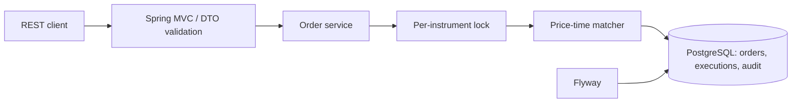
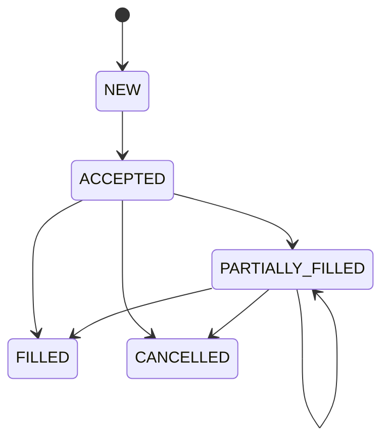

# Financial Market Order Management System (FOMS)

FOMS is a Java 21 / Spring Boot simulated exchange for portfolio and learning use. It never connects to a real venue, does not authenticate traders, and must not be used to trade real assets or money.

## Implemented scope

- PostgreSQL/Flyway persistence for instruments, orders, executions and audit events
- Limit and market order validation, lifecycle states, amendments and cancellation
- Deterministic, price-time matching with partial fills at the resting order's price
- Market orders are **IOC**: available liquidity is consumed and the remainder is cancelled
- Self-trade prevention stops matching at the first same-client order; it does not bypass that order to take later liquidity
- Per-instrument in-process serialization and optimistic entity versions
- Idempotent submission on `(clientId, clientOrderId)`: the same details replay the existing order (`200`); changed details return `409`
- Versioned REST API for instruments and orders, OpenAPI UI, health endpoint, validation/error DTOs, pagination

The API exposes instruments, order management, executions, audit history, order-book views, and basic statistics.

## Architecture



The service reads active persisted orders during each submission, so PostgreSQL is the durable source of truth rather than an unpersisted in-memory order book. A transaction persists order state changes, executions and audit events together. In-process locks make this safe only for one application instance; they provide no cross-instance coordination.

## Matching and lifecycle



For a buy, the lowest ask wins; for a sell, the highest bid wins. Equal prices use the earliest acceptance time. A crossing incoming order can execute against several resting orders. Example: a buy for 6 meets asks of 3 @ 99.00 then 5 @ 100.00, producing fills of 3 @ 99.00 and 3 @ 100.00. Quantity is integral and monetary values are `BigDecimal`; floating-point financial values are not used.

An amendment resets the accepted timestamp, deliberately losing queue priority. It currently changes eligible orders but does not immediately re-run matching; clients should submit a replacement order when immediate execution is required.

## Run locally

The fastest route is Docker:

```bash
docker compose up --build
```

Then use [Swagger UI](http://localhost:8080/swagger-ui.html), [OpenAPI JSON](http://localhost:8080/api-docs), or [health](http://localhost:8080/actuator/health).

To run without Docker, provide a PostgreSQL 16+ database and set `FOMS_DB_URL`, `FOMS_DB_USERNAME` and `FOMS_DB_PASSWORD`; then use JDK 21 and Maven:

```bash
./mvnw spring-boot:run
```

The Compose credentials are development-only defaults. Do not put production secrets in the repository or an `.env` file.

## Example

```bash
curl -X POST http://localhost:8080/api/v1/instruments \
  -H 'Content-Type: application/json' \
  -d '{"symbol":"ACME","name":"Acme Corp","assetType":"EQUITY","currency":"USD","tickSize":0.01}'

curl -X POST http://localhost:8080/api/v1/orders \
  -H 'Content-Type: application/json' \
  -d '{"clientId":"demo-a","clientOrderId":"ask-1","symbol":"ACME","side":"SELL","orderType":"LIMIT","quantity":10,"limitPrice":100.00}'
```

Additional read endpoints include `GET /api/v1/executions`, `GET /api/v1/orders/{orderId}/executions`, `GET /api/v1/orders/{orderId}/audit-events`, `GET /api/v1/order-books/{symbol}`, and `GET /api/v1/statistics/overview`.

## Verification

The current focused tests cover lifecycle validation and fills, price/time priority, non-crossing limits, self-trade behavior, and an MVC validation response. Run them with:

```bash
./mvnw test
```

This workspace has JDK 25 rather than JDK 21. For its local run only, the Mockito web-slice test required `-DargLine=-Dnet.bytebuddy.experimental=true`, because the bundled Byte Buddy version does not yet officially recognize JDK 25. This is not expected on the supported JDK 21.

## Limitations and next work

- Single process only; locks do not coordinate multiple instances.
- No user authentication or authorization; `clientId` is a simulation field, not a security identity.
- No real-market connectivity, high availability, risk controls, trading calendar, settlement, or regulatory controls.
- The in-process aggregated order-book read model is rebuilt from PostgreSQL at startup and refreshed only after committed order changes. Matching still queries persisted active orders; cross-instance coordination is not provided.
- Testcontainers integration coverage is included but depends on a Docker environment visible to the Testcontainers Java client. Concurrency tests, execution/order-book/statistics APIs, and measured benchmarks remain future work. No performance claims are made.
